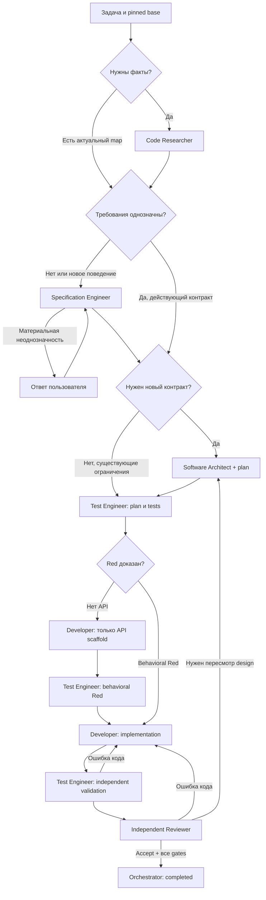

# Архитектура и workflow

## 1. Роли и основания для разделения

| Роль | Единоличная ответственность | Когда вызывать | Основной результат |
|---|---|---|---|
| Orchestrator | Маршрут, состояния, обязательные gates, эскалации | Всегда | Компактный итог и ссылки |
| Code Researcher | Факты о существующем коде, зависимостях и поведении | Когда нет актуального доказательного обзора | Research map с revision, файлами, символами и строками |
| Specification Engineer | Однозначность и полнота требований OpenSpec | Новое/неясное поведение, устаревшая спецификация | Валидированная ссылка на требования или вопросы |
| Software Architect | Минимальный контракт решения и последовательность работ | Новые границы/API/зависимости, сложность или риск | Design + tasks в существующей структуре OpenSpec |
| Test Engineer | Независимые ожидания, тесты до реализации, итоговая валидация | Любое изменение исполняемого поведения | Test manifest, Red evidence, independent Green |
| Backend Developer | Реализация принятого поведения | После gates спецификации, архитектуры и тестов | Production patch и собственные проверки |
| Independent Reviewer | Независимая оценка полного изменения | Перед завершением изменения кода | Конкретные findings либо accept |
| Workspace Operator | Снимки, статус, механическое обслуживание артефактов | Только если требуется общая операция | Manifest/diff reference/integration receipt |

Implementation Planner не выделяется: последовательность изменений и зависимости задач включаются архитектором в существующий `tasks`-артефакт. Он не определяет ожидаемые результаты тестов. Не нужны отдельные агенты форматирования, запуска сборки, архивации, объяснения и диспетчеризации моделей.

Infrastructure services — не LLM-роли: state store, artifact store, policy gateway, isolated runner. Их можно реализовать небольшими адаптерами к существующим CI и хранилищам; не требуется создавать новую платформу целиком. Они проверяют права и доказательства независимо от модели.

## 2. Центральный оператор или запись специалистами

| Вариант | Контекст | Безопасность | Вызовы и сложность |
|---|---|---|---|
| Каждая запись через Workspace Operator | Оператор вынужден получать большие patches и семантику чужих задач | Одна точка записи, но широкие права и риск confused deputy | Дополнительные вызовы на каждый edit; конкуренция и много передач |
| Специалисты пишут в выделенные зоны | Код и тесты остаются в профильных контекстах | Узкие capabilities, проверка публикации, независимые identities | Прямая работа; оператор только для общих операций |

Выбран второй вариант. Оператор не решает, как исправлять production-код или тесты, и не может по свободному тексту применить произвольный patch. Атомарное применение проверенного bundle в интеграционный снимок выполняет сервис с provenance-проверкой. Если такой сервис недоступен, человек выполняет интеграцию; нельзя выдавать оператору общий shell как замену ограничениям.

## 3. Канонические артефакты

В OpenSpec остаются бизнес-требования, предложение изменения, архитектурное решение и план, в тех местах, которые определены установленной версией и схемой проекта. Типичная структура `openspec/specs/` и `openspec/changes/<change-id>/` — пример, не жёсткий путь. Не создавать рядом `requirements-v2.md` или отдельный реестр бизнес-требований.

Исследования, запуски, review и manifests хранятся в отдельном служебном artifact store. Они содержат ссылки на OpenSpec, а не конкурирующие копии требований. Runtime хранит состояние этапов и hashes, но не заменяет `tasks`-артефакт. Его отметки обновляет Workspace Operator механически по проверенным receipts, без изменения текста задач. Специалист владеет смыслом своего документа; оператор не переписывает его выводы.

Specification Engineer меняет proposal/delta requirements в разрешённом change. Architect меняет design/tasks того же change. Запись в утверждённые main specs и архивирование выполняется только через принятый в проекте процесс после завершения; закрытие данной разработки не означает автоматический merge, archive или release.

## 4. Основной маршрут

Workspace Operator обеспечивает снимки на границах этапов по запросу, а не входит дополнительным обязательным шагом в каждую стрелку. Diagram упрощает ветви; нормативные условия ниже.

## 5. Состояния и gates

Runtime допускает переход только по проверенным receipts. Агент может предложить переход, но не подтвердить собственные права или подделать чужую аттестацию.

| Состояние | Условие выхода | Владелец доказательства |
|---|---|---|
| INTAKE | task_id, scope, base snapshot, явные ограничения | Runtime + Orchestrator |
| CONTEXT_READY | Актуальный research либо обоснованное reuse, карта инструментов | Researcher/проверенный cache |
| SPEC_READY | Ссылки на применимые требования; нет существенных нерешённых вопросов | Specification Engineer либо действующий принятый spec |
| DESIGN_READY | Новый contract или зафиксированные применимые ограничения существующего design | Architect либо проверенный existing contract |
| TESTS_LOCKED | Сценарии и исполняемые test sources опубликованы до новой логики; manifest+hash | Test Engineer + artifact service |
| API_SCAFFOLD | Только если API отсутствует: утверждённые signatures, никакой новой бизнес-логики | Developer + проверка Test Engineer |
| RED_CONFIRMED | Поведенческое падение по нужной причине на base/scaffold, baseline классифицирован | Test Engineer + runner |
| IMPLEMENTING | Red и все предыдущие gates актуальны | Runtime |
| CANDIDATE | Production bundle, test hash сохранён, self-checks | Developer + publisher |
| VALIDATED | Независимые обязательные compile/test/format checks на точном candidate | Test Engineer + runner |
| REVIEWED | accept; нет открытых блокирующих findings, review относится к тому же snapshot | Reviewer |
| DONE | Совпадают hashes spec/design/tests/candidate/checks/review; scope соблюдён | Runtime gate + Orchestrator |

`BLOCKED`, `FAILED`, `CANCELLED` — боковые состояния; сохраняют last_valid_state и причину. DONE означает завершение разработки и проверки, не публикацию. Документальное изменение без изменения поведения может иметь `not_applicable` для тестов с проверяемой причиной и одобрением reviewer; это не обход для «маленького» изменения Scala.

Для чистого рефакторинга существующие characterization tests могут быть зелёными на base. Test Engineer до кода фиксирует покрытие инвариантов и `not_applicable: no new behavior`; reviewer подтверждает причину. Не придумывать искусственный Red для уже существующего поведения. Для новой/исправляемой логики behavioral Red обязателен.

## 6. Независимое тестирование и отсутствующий API

Test Engineer до реализации видит pinned base, существующие тесты, OpenSpec и публичный контракт. Он не видит новую реализацию или рассуждения Developer. Expected values выводит из требований. Старый код помогает понять test harness, но не служит единственным oracle.

Если API существует: написать тесты → запустить на base → зафиксировать конкретный assertion failure и сохранение существующей регрессии. Падение из-за недоступной БД, зависимостей или синтаксической ошибки теста не считается Red.

Если API отсутствует:

1. Test Engineer публикует сценарии и test sources до новой production-логики; попытка компиляции может дать только `red_kind=missing_api`. Это промежуточное свидетельство, не behavioral Red и не разрешение полной реализации.
2. Architect заранее определяет signatures. Developer получает ограниченную задачу scaffold: только эти объявления и явно незавершённое поведение; такой снимок никогда не принимается как production-результат.
3. Test Engineer сверяет scaffold с контрактом, исправляет только собственные ошибки тестового кода и повторно фиксирует manifest. Запускает тесты до реализации; они должны компилироваться и падать на целевом поведении. Подтверждает, что scaffold не содержит готовой новой логики.
4. Runtime открывает IMPLEMENTING лишь после behavioral Red. В исключительных случаях невозможности такого запуска требуется переработать контракт/окружение; не подменять Red описанием сценариев и не объявлять gate пройденным.

После реализации Test Engineer получает candidate в режиме verification. Он может читать новую реализацию для диагностики, но frozen expectations остаются привязанными к spec. Дополнительные тесты помечаются post-implementation и не выдаются за предварительные. Изменение существующего oracle допускается только по ошибке теста или изменённому spec: отдельная версия, причина, reviewer-проверка, повторная валидация. Developer тесты не правит.

## 7. Возвраты и инвалидирование

| Событие | Следующее действие | Что теряет актуальность |
|---|---|---|
| Реализация нарушает spec | Developer исправляет production | Green и review |
| Тест противоречит явному spec | Test Engineer исправляет тест; Reviewer проверяет причину | Test manifest, Red при изменении oracle, Green, review |
| Бизнес-неоднозначность | Specification Engineer готовит варианты → пользователь | Все downstream artifacts, зависящие от изменённого требования |
| Нужны новая граница/API/зависимость | Architect пересматривает design до продолжения | Зависимые tests, implementation, checks, review |
| Избыточная архитектура | Developer упрощает в рамках contract; Architect только при споре | Green и review |
| Tool timeout / недоступный registry | Повтор с тем же snapshot при transient failure | Никаких новых passed receipts |
| Конфликт записи / изменился base | Новый snapshot, проверка delta; нельзя переиспользовать старый accept | Затронутые gates |

Одновременно только один writer на артефакт/путь; публикация через compare-and-swap по base hash. При изменениях spec или design dependency graph определяет, что пересмотреть; сомнение означает инвалидирование, а не молчаливое reuse.

Максимум один повтор transient tool failure с теми же входами. Максимум два цикла исправления на один finding и три суммарных возврата назад на задачу. После лимита — blocked, причина и конкретный вопрос/варианты пользователю. Изменение формулировки finding не сбрасывает счётчик. Новый согласованный scope создаёт новую ревизию, а не бесконечный цикл. Reviewer не исправляет даже тривиальные замечания.

## 8. Сокращённый маршрут и walkthrough

Для локального изменения существующего метода можно reuse актуальные research/spec/design. Orchestrator не делает вывод о простоте по коду: получает заверенный scope assessment от Researcher или использует уже проверенный manifest. Условия: нет нового публичного API, зависимости, схемы хранения, конкурентности, межмодульного контракта или бизнес-неоднозначности. Даже тогда Test Engineer работает до Developer; независимые validation и review сохраняются. Если assessment неполон — обычный маршрут.

Change Walkthrough — отдельная пользовательская задача: Orchestrator передаёт Researcher выбранный диапазон и skill в свежий контекст. Researcher получает diff и код напрямую, строит обзор 3–7 опорных точек, сохраняет его как артефакт для пользователя; Orchestrator получает лишь summary и ссылку. Доработка кода и обязательный повтор всех checks этим запросом не подразумеваются.
